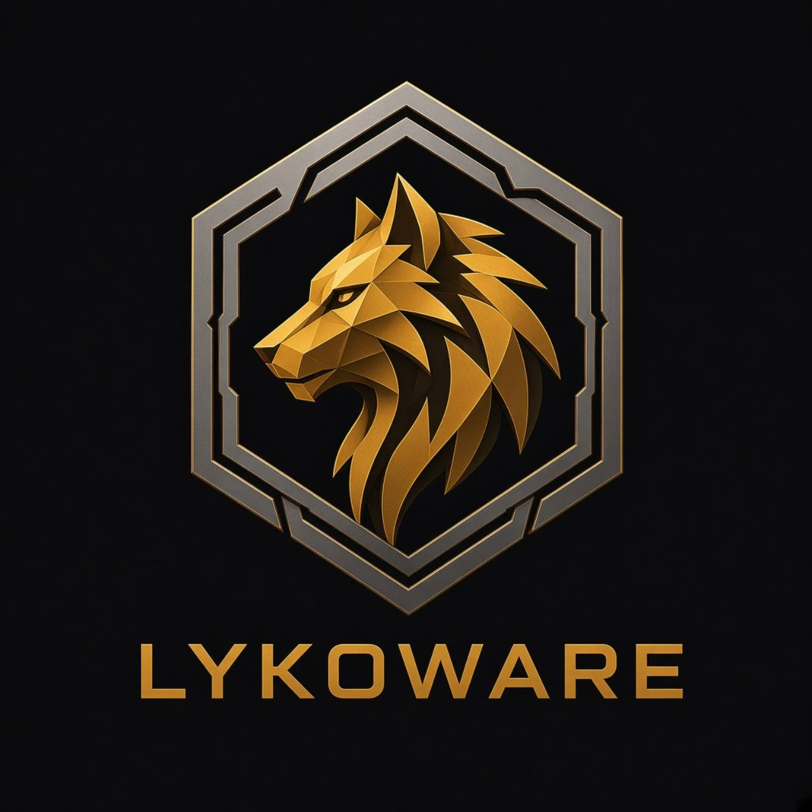

# Lykoware (lykowareGE)

[Branding reference](docs/BRANDING.md)

Lykoleon Studios' Windows-first, AI-native engine. Standard: **No limits. Just excellence.**
Build the flagship first: open-world RPG, first-/third-person action, structural sandbox construction, and RTS-scale battles.

The [master brief](docs/LYKOWARE_BRIEF.md) records product direction. Later owner instructions and accepted [ADRs](docs/adr/README.md) govern technical choices; [STATUS](docs/STATUS.md) records what actually works.

## Core rule: full ownership

Lykoleon builds and controls the original engine, custom editor, content tools, asset pipeline and agent integration. No dependency on Unity/Unreal/Godot/Blender or their editor plugins. Pragmatic low-level MIT/BSD/Apache/zlib libraries must be vendored as source forks under third_party, retain upstream terms, and sit behind replaceable Lykoware interfaces. No copyleft in shipped code or proprietary middleware lock-in.

Every tool/content operation must be reachable through CLI and scripting, with diffable authored data. Runtime **Phases 0–6 first**, full editor **Track E later**, built-in content suite **Track C after E2**. Early tools are CLI, debug overlay, profiler and capture only.

## Start here

- [Status: implemented, current, next, known issues](docs/STATUS.md)
- [Owner vision and remaining questions](docs/ENGINE_VISION.md)
- [Roadmap and exit criteria](docs/ROADMAP.md)
- [Architecture](docs/ARCHITECTURE.md) and [data ownership](docs/DATA_FORMATS.md)
- [Architecture decisions](docs/adr/README.md)
- [Performance targets and evidence requirements](docs/PERFORMANCE.md)
- [Shared agent instructions](AGENTS.md), [contributing](CONTRIBUTING.md), [handoffs](docs/WORK_BOARD.md)
- [Build instructions](docs/BUILDING.md) and [checklist](CHECKLIST.md)

## What actually runs

A C++20/CMake engine library, console sandbox, and native **lyko** CLI. `lyko build` and `lyko test` call the CMake/CTest presets without a shell. `lyko run` launches the console sandbox. `lyko trace --frames N` writes a CPU Chrome trace of that sandbox loop. `lyko run --scene` and `screenshot` return an explicit unsupported-renderer error. The engine also has a GPU-free image harness used by CTest; it is a software pattern and PPM comparison, not a renderer screenshot. Compiler warnings are errors by default; Linux ASan/UBSan and clang-tidy 18 presets are available. Provisional CPU-only budgets run in CTest for the pinned hosted runners.

See [build instructions](docs/BUILDING.md), [CLI contract](docs/CLI.md), and [STATUS](docs/STATUS.md) for current verification. There is no window, renderer, physics, scene loader, or editor yet.

Joshua selected **C++20 with CMake** in [ADR 0001](docs/adr/0001-language.md). [ADR 0002](docs/adr/0002-graphics.md) accepts Vulkan 1.3 from C++ behind an owned RHI. [ADR 0004](docs/adr/0004-data-formats.md) accepts canonical JSON, TOML for hand-edited config, and glTF 2.0 for meshes. Jolt remains proposed in [ADR 0003](docs/adr/0003-physics.md); if adopted, it is called natively from C++, not through bindings. No graphics or parser dependency is vendored yet.

## Product boundaries and release policy

Lykoleon Studios is the studio; Lykoware is the runtime; Howler: Initiation is the future custom development application; Pax is future anti-cheat and the required public-release review gate.

Private development; GitHub-only repositories. Nothing public without Pax review and owner authorization. No personal data to outside AI services. Any spend needs prior approval. See [ownership policy](docs/adr/0000-ownership-and-licensing.md) and [proprietary notice](LICENSE).

Keep the current repository name until Joshua confirms a rename.
